  

 

---

## 👋 Sobre mim

Sou **Walace Fonseca**, natural do **Rio de Janeiro** e formado em **Análise e Desenvolvimento de Sistemas (ADS)** pela **UVA**.

Tenho **7 anos de experiência em TI**, com foco crescente na área de **dados**. Trabalho com **SQL e MySQL**, análise de indicadores e acompanhamento de chamados no **Jira**, apoiando a tomada de decisão e a melhoria de processos.

Minha base em **suporte, infraestrutura e segurança da informação** me dá uma visão completa do ambiente em que os dados são gerados e utilizados.

## 🤖 Linguagens e Tecnologias

&nbsp;&nbsp;&nbsp;&nbsp;&nbsp;&nbsp;

## 📊 BI e Dados

&nbsp;&nbsp;&nbsp;

## 🛠️ Ferramentas e Infraestrutura

&nbsp;&nbsp;&nbsp;&nbsp;&nbsp;&nbsp;&nbsp;&nbsp;&nbsp;&nbsp;&nbsp;&nbsp;

---

## 📊 Estatísticas do GitHub

 

---

## 🤝 Vamos conversar?

Se você trabalha com dados, BI ou quer trocar ideias sobre carreira em TI, vai ser um prazer conectar.

